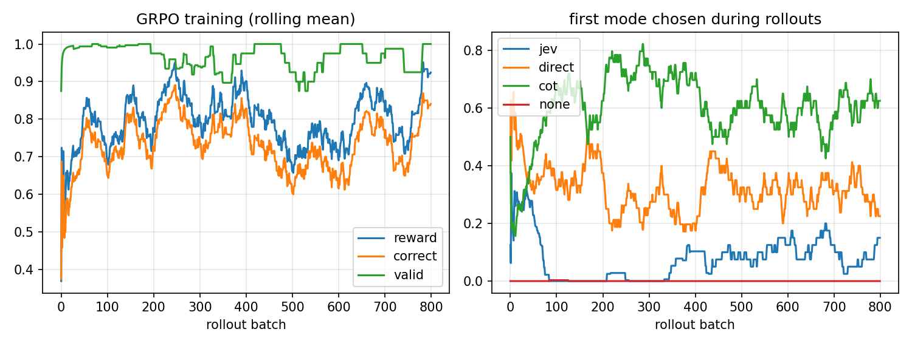
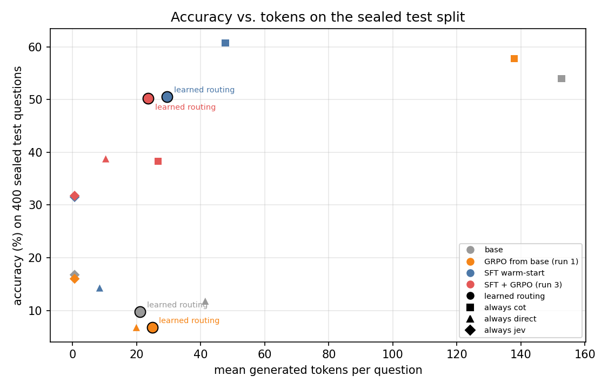

# Knowing When to Think: teaching a 1.7B model to switch between fast decisions, direct answers and reasoning

Some questions need step-by-step reasoning. Others are a lookup or a choice from a short list, and reasoning through them wastes tokens. Reasoning models usually either always think or let the user flip a switch. This project asks a narrower question: **can one small model learn, per question, whether to decide fast, answer directly, or reason, and switch partway through when that helps?**

It is a small open-source piece of a larger research direction on teaching models to switch reasoning modes. Everything here runs on [Qwen3-1.7B](https://huggingface.co/Qwen/Qwen3-1.7B) with LoRA, trained with [Tunix](https://github.com/google/tunix) (JAX) on a **single spot TPU v5e chip at about $0.50 an hour**.

## Three modes, one model

The model starts every answer with a mode tag:

| mode | what the runtime does | example |
|---|---|---|
| `<mode:jev>` | **no generation**: one forward step, logits restricted to the option letters, argmax | `<mode:jev>`<br>`C` |
| `<mode:direct>` | short capped generation, no reasoning budget | `<mode:direct>`<br>`<answer>9544</answer>` |
| `<mode:cot>` | free reasoning, which can **hand off to JEV** for the final choice | `<mode:cot>`<br>`There are 18050 items. Dividing by two gives 9025.`<br>`<mode:jev>`<br>`B` |

"JEV" is a fast, typed decision: pick one of the given options. It is inspired by [JEV-style decision models](https://github.com/avbiswas/bev-train). The switching is native: when the model emits `<mode:jev>`, the runtime ([kwt/runtime.py](../kwt/runtime.py)) stops generating text and runs a single masked forward pass. It returns the chosen letter and a probability for each option.

## The simplification that made RL possible

The first version of this project ([postmortem](../POSTMORTEM.md)) bolted a separate candidate-scoring head onto Qwen. That needed a custom RL learner mixing token log-probabilities with categorical head actions. Supervised training worked. Reinforcement learning never got a stable sampled update onto the TPU, because of NaNs, compiler stalls and operational failures. Most of the budget went on validation gates around that learner.

The fix was to notice that **a JEV decision is already a categorical choice over a few tokens**. If the options are labelled A–F and each letter is a single token, choosing an option is just one constrained next-token step in the language head. Stock token-level GRPO can then train the whole policy (mode choice, reasoning and decision) with no custom learner. Only the inference runtime treats JEV specially.

## Rewards: no reward for picking a mode

The GRPO reward ([kwt/rewards.py](../kwt/rewards.py)) has three terms:

- **correctness**: 1 if the answer exactly matches the gold value. A JEV letter is mapped to its option first. There is no substring credit, because that is easy to game.
- **format**: +0.1 for a valid trace, −0.2 otherwise.
- **compute cost**: −0.002 per ~token, capped at 0.6 so cost never outweighs a correct answer.

Nothing rewards choosing a particular mode. Any routing has to come from the trade-off between accuracy and tokens.

## Data

The 1,024 training tasks come from the project's verified single-turn episodes: fast comparisons, direct arithmetic, multi-step word problems including GSM8K training items, and "reason then decide" problems. Whether lettered options are shown decides whether JEV is available at all. An 80-question validation split was used during development. A **400-question test split was kept sealed** until the final evaluation. Wording that encoded the old forced routes ("Please solve this task:") was stripped.

## Run 1: RL from the base model collapsed

GRPO straight from Qwen3-1.7B (200 steps, 8 samples per prompt) failed instructively. The base model almost never wrote a valid mode tag; on validation, only 4% of its traces were valid. The cheapest valid format, `<mode:direct>`, was the only thing that ever scored, so GRPO pushed the whole policy onto it. After training, the policy chose direct for 100% of test questions and scored 6.8%, worse than the base model's 9.8%. RL can only sharpen choices the policy already makes.

## Run 2: a short warm-start is what makes switching appear

The fix was 256 steps of supervised warm-start, which took 3.5 minutes on the TPU. It trains on traces rendered from each episode's verified mode sequence, so all three formats are in the policy before RL starts. That alone changed everything. On the **400 sealed test questions**, learned routing went from 9.8% to **50.5%**, with 100% valid traces. The model now uses all three modes and picks them by task type:
- 76% of fast comparisons go straight to JEV;
- 74% of "reason then decide" problems start in CoT;
- a third of all traces switch from CoT to JEV partway through.

GRPO from this checkpoint at the first learning rate (3e-6) changed nothing measurable: 50.7% on test. The LoRA weights had moved by only about 0.5%. A small gain on the 80-question validation split (62.5% to 70%) turned out to be near-tie routing flips that did not replicate on the test split. I mention it because it was tempting to report.

## Run 3: GRPO at a LoRA-sized learning rate trades tokens, not accuracy

At a 10× higher learning rate (3e-5), starting from the same warm-start checkpoint, GRPO clearly moved the policy. Comparing the first 100 rollout groups with the last 100:
- the average trace shrank from 94 to 36 characters;
- rollout accuracy rose from 69% to 76%;
- the share of traces that **reason briefly and then hand off to a JEV decision** rose from 38% to 61%.

The model learned that a one-line calculation followed by a JEV pick usually earns the full reward at a fraction of the cost:

```
<mode:cot>
(4682*2)+78=9442
<mode:jev>
D                      ← correct; JEV gives D probability 1.00
```



**Sealed test results (400 questions, never looked at during development):**

| model | learned routing accuracy | mean generated tokens | first mode (JEV / direct / CoT) |
|---|---|---|---|
| Qwen3-1.7B base | 9.8% | 21 | mostly no valid tag |
| GRPO from base (run 1) | 6.8% | 25 | 0% / 100% / 0% |
| warm-start | 50.5% | 29.5 | 28% / 39% / 34% |
| warm-start + GRPO, lr 3e-6 (run 2) | 50.7% | 29.6 | 28% / 39% / 34% |
| **warm-start + GRPO, lr 3e-5 (run 3)** | **50.2%** | **23.6** | 14% / 39% / 47% |
| warm-start, always CoT | 60.8% | 47.7 | forced |
| run 3, always direct | 38.8% | 10.3 | forced |



The run 3 model kept the warm-start's accuracy while generating **20% fewer tokens**. With 400 questions, the 95% interval on accuracy is roughly ±5 points, so "same accuracy" is the honest reading. The gains and losses were uneven:
- **fast decisions** improved from 58% to 82%;
- forced **direct** answers improved from 14% to 39%;
- **multi-step reasoning** fell from 50% to 37%, and "reason then decide" from 68% to 58%;
- forced CoT dropped from 61% to 38%. The model now ends almost every reasoning trace with a JEV hand-off, which is invalid when no options are shown.

## What this does and does not show

- **Native switching works.** One 1.7B model picks a mode per question, switches from reasoning to a single-step decision partway through a trace, and the runtime really executes the decision differently.
- **The warm-start did the heavy lifting.** RL from the base model collapsed. RL from the warm-start learned to spend fewer tokens at equal accuracy. That is a cost reduction, not an accuracy gain.
- **Learned routing does not beat always-CoT on accuracy.** Forcing CoT on the warm-start model scores 60.8% at 48 tokens. Learned routing scores about 50% at 24–30 tokens. Whether that trade is worth it depends on the task. The cost weight of 0.002 per token pushed the policy further toward brevity than these arithmetic-heavy tasks reward, and the next experiment is to lower it.
- **Some of the "reasoning" is a hint, not a derivation.** Several correct run 3 traces contain arithmetic that is wrong (for example `(7212*7213)+59=79981`) followed by a correct JEV pick. The reward checks only the final answer, so it cannot tell faithful reasoning from a useful scratch note.
- Token counts ignore that JEV still processes the whole prompt in one forward pass. Wall-clock latency was not measured.
- This is one seed, one model size and small arithmetic-flavoured tasks. Lookup and clarification episodes, which are multi-turn, are left out.

## Cost

The whole experiment took about 7.5 spot v5e-1 VM-hours, including:
- five launches that failed on configuration or out-of-memory errors;
- two spot preemptions;
- every evaluation.

That came to roughly **$4** at about $0.50 per hour. Every VM deletes itself in four situations, all handled in [scripts/vm_startup.sh](../scripts/vm_startup.sh):
- the job finishes or crashes;
- the log goes silent;
- the VM hits its budget deadline;
- the laptop that launched it stops sending a heartbeat.

## Try it

```bash
pytest tests/test_kwt.py
MODULE=kwt.pipeline bash scripts/tpu.sh launch myrun 3     # warm-start -> GRPO -> eval on one spot v5e chip
python -m kwt.demo --lora runs/kwt/run3/grpo/lora.npz --ask "Is 3029 more than 3030?" --options yes no
```

Fresh-inference demo traces from the run 3 model are in [demo-kwt-run3.json](demo-kwt-run3.json).

Code: [github.com/TinevimboMusingadi/knowing-when-to-think-fast-slow](https://github.com/TinevimboMusingadi/knowing-when-to-think-fast-slow). The earlier custom-head draft is kept in [article-custom-head-draft.md](article-custom-head-draft.md).
