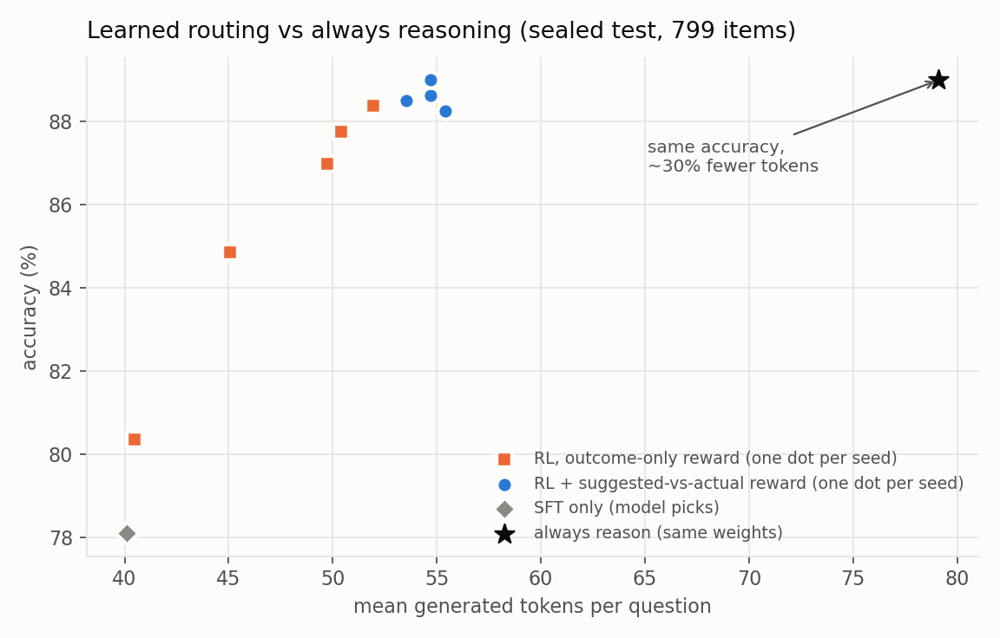
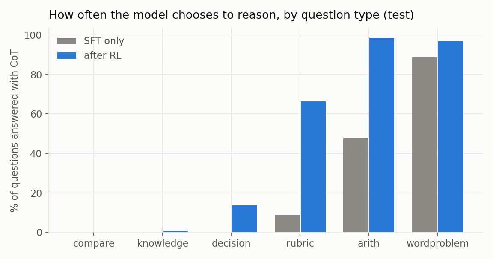
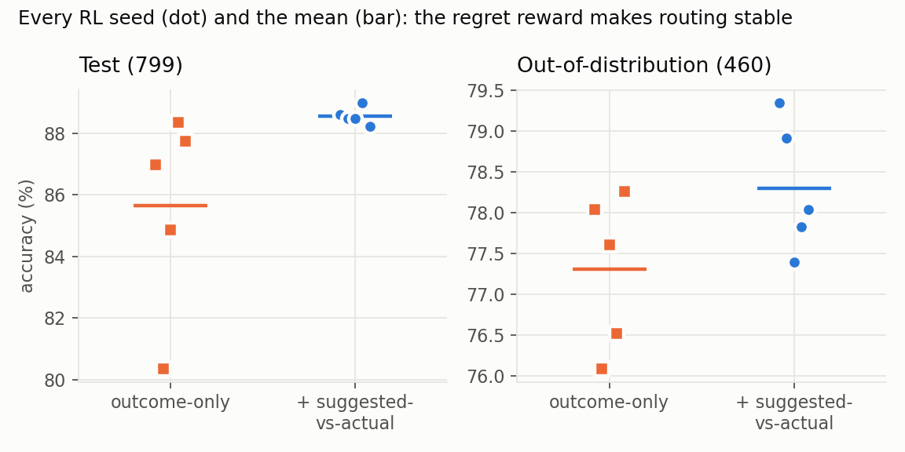
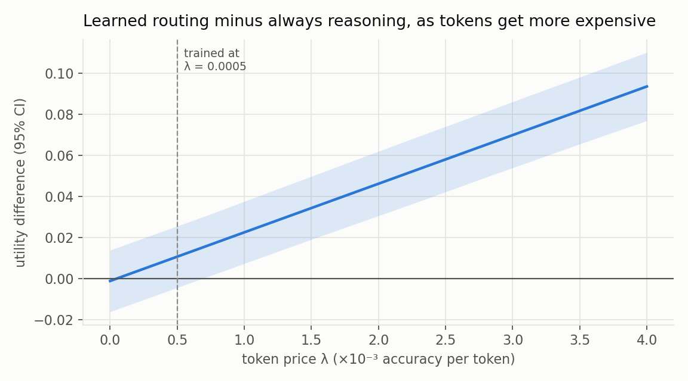

# Teaching a 4B model when to think, by measuring it first

*Part 2 of "Knowing when to think". [Part 1](article.md) built the machinery. This post is about the data and the reward that made it work.*

Most reasoning models either always think or let the user flip a switch. I wanted something narrower: **one small model that decides, question by question, whether to think at all**. It should pick one of three ways to answer:

| mode | what happens | cost |
|---|---|---|
| `<mode:jev>` | **no text at all**: a single forward step picks an option letter | 1 token |
| `<mode:direct>` | a short answer | ~10 tokens |
| `<mode:cot>` | a few lines of reasoning, then an answer or a JEV pick | ~80 tokens |

The model writes a mode tag, and the runtime then *executes* that mode, so JEV really is one forward pass.

**The headline, on a sealed test set of 799 questions:** Qwen3-4B, choosing its own mode, is **as accurate as always reasoning (88.6% vs 88.5% mean over 5 seeds) while generating about 30% fewer tokens and answering ~20% faster**. On an out-of-distribution set it does the same. Once tokens carry even a modest price, the choice is a significant win; it never loses. The whole v2 project, including 10 RL runs, cost roughly **$40 of spot TPU time**.

## What went wrong in part 1

The first version used a 1.7B model. Learned routing ended up **11 points worse** than simply always reasoning.

Digging into the data showed why. Each training question carried a label saying which mode to use, but **the labels were set by the data generator, not by what the model could actually do**. The same kind of arithmetic problem appeared labelled "fast", "direct", "reason" and "reason then decide". "Direct" included things like *split 10014 and 92 items equally*, which a 1.7B model can't do without working it out (24% accuracy). The model learned to route on wording, and RL had nothing clean to correct it with.

So the rule for v2 was: **don't decide which mode a question needs; measure it.**

## Step 1: measure every question in every mode

I built a 13k-question pool across six kinds of question:
- one-step decisions from [bev-decision](https://huggingface.co/datasets/avbiswas/bev-decision-150K), a dataset made for exactly this kind of typed choice;
- maths word problems (GSM8K, AQuA);
- science and commonsense multiple choice (ARC, OpenBookQA, CommonsenseQA);
- generated comparisons, arithmetic and scoring rules, each with a difficulty knob.

Then I ran **Qwen3-4B itself on every question in every mode**, four samples each, and recorded how often each mode was right and how many tokens it used. Each question's label is the mode with the best *accuracy minus a small price per token*.

That changed what the labels said, in ways no human labeller would have guessed:
- **Number comparisons**, which the 1.7B model needed to reason about, are a one-step JEV decision for 4B at every digit count. The labels are relative to the model, not the task.
- **Scoring rules** flip from "just pick" at depth 1 to "reason" at depth 2–3.
- **Word problems** need reasoning more often as they get longer.

Data science work that mattered:
- **Schema checks** caught 2.4% of AQuA items with duplicate options or the right answer listed twice.
- **Near-duplicate removal** ran *before* splitting, so nothing leaks into the test set.
- **Balancing:** my own generators had put "yes" in option A every time.
- **A label-stability check:** labels from half the samples agree with the other half 89% of the time.
- **An answer audit:** the model, reasoning at full length, flagged questions where it confidently disagreed with the answer key. Reviewing those by hand found real errors: about 0.4–1.7% in the maths and science sets, plus ~10% genuinely ambiguous CommonsenseQA questions. I fixed two wrong test answers, for example a GSM8K problem whose official answer is $115 when the arithmetic gives $95.

The full details are in the [datasheet](data-v2/DATASHEET.md).

One honest check before training: **is there anything to learn?** A perfect per-question router beats the best "one mode per question type" rule by about **6 utility points**. That's real headroom, but not a huge prize. It's also why the results below are about tokens and stability rather than big accuracy jumps.

## Step 2: does the model already know when it needs to think?

Before the model generates anything, I took its internal state at the end of the question and trained a simple linear probe to predict whether each mode would succeed. It works surprisingly well:

| mode | AUROC on held-out questions |
|---|---|
| one-step pick | 0.90 |
| direct answer | 0.94 |
| reasoning | 0.91 |

AUROC is the chance the probe ranks a right answer above a wrong one; 0.5 is guessing and 1.0 is perfect. So **the model largely "knows" in advance whether it can answer without thinking**. As a router on its own, though, the probe only ties a simple per-question-type rule: when two modes are nearly as good, small errors flip the choice. So I used it to *shape* training rather than to decide.

## Step 3: teach the tags as switches, then let RL choose

**SFT** (one epoch, ~70 minutes) mixes two kinds of example:
- **Obedience:** the system prompt says `Mode: cot` (or `jev`, `direct`), and the model must answer in that mode. After SFT, forced-mode obedience is **100%**, so the tags really do switch reasoning on and off.
- **Routing:** with `Mode: auto`, the target is the measured best mode.

The reasoning examples are the model's *own* shortest correct samples. I dropped any whose arithmetic doesn't check out; even the base model writes a false equation in 8% of its checkable traces and still gets the right answer most of the time.

SFT alone under-thinks. It picks the one-step mode 71% of the time and reaches 78%, ten points below always reasoning.

**RL (GRPO)** fixes that. The reward is:
- **correctness:** exact match;
- **format:** disobeying a forced mode is the worst outcome;
- **token cost:** only charged on correct answers, so short-and-wrong never beats long-and-right;
- **suggested-vs-actual mode regret:** a small penalty proportional to how much worse the chosen mode is predicted to be than the best mode for that question. It fades to zero over the first 60% of training, so real outcomes have the last word.

## Results

Each RL setting was trained with 5 different random seeds:

| model (choosing its own mode) | test accuracy | tokens | out-of-distribution |
|---|---|---|---|
| SFT only | 78.1% | 40 | 69.3% |
| RL, outcome-only reward | 85.7% mean (80.4–88.4) | 41–52 | 77.3% mean (76.1–78.3) |
| **RL + suggested-vs-actual reward** | **88.6% mean (88.2–89.0)** | **53–55** | **78.3% mean (77.4–79.3)** |
| always reason (same weights) | 87.7–89.0% | 76–82 | 77.4–79.1% |

What RL learned is easy to see by question type: reason on multi-step scoring rules and arithmetic, and keep answering comparisons and knowledge questions in one step.

### The suggested-vs-actual reward buys stability

The most interesting result came from re-running each setting with 5 random seeds:

- **Outcome-only RL is fragile:** test accuracy ranges from **80.4% to 88.4%** (sd 3.2). Plot each seed's accuracy against its token use and the seeds fall on a line. Each run has settled on a different amount of under-thinking, and the ones that think least score worst.
- **With the regret term, the seeds land on top of each other:** **88.2–89.0%** (sd 0.3), all at about the same token budget.

That's **+2.9 points on average and 12× less run-to-run spread** (exact permutation test over seeds, p = 0.008). Out of distribution the direction holds (+1.0 point) but the gap is small and not significant (p = 0.07), so the stability gain is clearest on in-distribution questions.

**Why might this happen?** Outcome-only RL only sees whether *this* sample was right. Early on, cheap one-step answers are often right, so a run can drift toward thinking less, and how far it drifts depends on the luck of its samples. The regret term carries a fixed, measured reminder of which questions actually need reasoning for this model, so every run is pulled toward the same routing.

It also doesn't matter much where the regret comes from. Using the exhaustively measured labels or the cheap hidden-state probe gives the same result (88.2% vs 88.6%). So the probe is enough, which also means you don't need to profile your RL prompts.

### Is it worth it? It depends on what a token costs

At the token price I trained with, learned routing *ties* always-reasoning on accuracy-minus-cost, and the saving is the robust part. Re-price the same outputs and the picture sharpens: from about **λ = 0.001** (100 tokens worth 10 accuracy points) upward, learned routing **significantly** beats always reasoning, and it never loses.

### Wall-clock time

Tokens aren't time, so I also timed 160 test questions one at a time on a single v5e chip, after a warm-up pass so compile time doesn't count:

| | mean | median | 90th percentile |
|---|---|---|---|
| model picks its mode | **1.74 s** | **1.59 s** | 2.63 s |
| always reason | 2.19 s | 2.28 s | 2.87 s |

That's **~20% faster on average and ~30% at the median**. It's smaller than the token saving because my runtime has fixed overhead:
- it decodes a short "header" before switching modes;
- each switch re-reads the prompt instead of reusing the cache;
- every generation call has a fixed setup cost.

Even a one-step JEV answer takes 1.67 s in this runtime, though in principle it's a single forward pass. A serving stack that stops at the mode tag and keeps the KV cache would turn most of the token saving into time saved.

## What didn't work

- **Rewarding true arithmetic in the scratch work** didn't change how often equations were true (~96–97% either way) and cost ~0.8 points.
- **Rewarding the right "genre" tag** didn't help either.
- **RL on one 16 GB chip** wasn't possible for 4B. Tunix's training step returns a second full copy of the frozen weights, so RL ran on a 4-chip slice (~$2/hour spot). Data work, SFT and evaluation stayed on one chip at ~$0.50/hour.
- **About a dozen bugs** were caught by tiny smoke runs before they could waste a full run, most of them out-of-memory problems. My favourite: the reasoning prompt said "end with `<answer>FINAL</answer>`", and the model dutifully wrote the word FINAL.

## Limits

- **One model size, single-turn questions, mostly maths and multiple choice.**
- **The labels describe the base model.** SFT made reasoning better (80% → 89%), so they are partly stale by the time RL runs.
- **Some decision questions** (which headline got more clicks, a wine's rated quality) have answers no mode can reliably reach.

## What's next

The same recipe should transfer to a small **omni** model, where the modes become things like "answer from the image directly", "describe then reason" and "pick an option". The steps are the same:
1. measure each mode on the model;
2. teach the tags as switches;
3. use a regret signal to keep RL stable.

*Code, data scripts and every number in this post: [github.com/TinevimboMusingadi/knowing-when-to-think-fast-slow](https://github.com/TinevimboMusingadi/knowing-when-to-think-fast-slow) (branch `kwt-text-modes`). The technical write-up with all confidence intervals is [paper-v2-draft.md](paper-v2-draft.md).*
